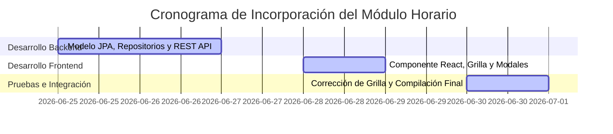

# INFORME TÉCNICO N° 005-2026 — INCORPORACIÓN DE MÓDULO HORARIO AULA AIP
**I.E. HUANOQUITE — COORDINACIÓN DE INNOVACIÓN Y SOPORTE TECNOLÓGICO (CIST)**

---

**A:** Dirección de la Institución Educativa Huanoquite  
**DE:** Ing. Eddam Eloy Huallpa Lima — Especialista CIST  
**ASUNTO:** Informe Técnico de Avance sobre la Incorporación del Módulo de Horario y Reserva de Aulas Pedagógicas al Sistema "Intranet JEC"  
**FECHA:** 01 de Julio de 2026  
**PERIODO DE TRABAJO:** 25 de Junio de 2026 al 01 de Julio de 2026  

---

## 1. INTRODUCCIÓN Y JUSTIFICACIÓN
En el marco de la mejora continua de la plataforma **Intranet JEC** (desplegada en su versión v001 para operar offline dentro de la LAN de la escuela), la Coordinación CIST identificó la necesidad imperativa de gestionar de forma digital las horas pedagógicas del **Aula de Innovación Pedagógica (AIP)**. 

Anteriormente, la coordinación de horarios se realizaba de forma física o mediante cuadernos de apuntes, lo cual acarreaba los siguientes problemas:
- **Traslapes de Horario:** Dobles reservas de docentes en una misma hora de clase, interrumpiendo el normal dictado de sesiones.
- **Subutilización de Recursos:** Horas libres del Aula AIP que no eran aprovechadas por falta de visibilidad en tiempo real para el resto de docentes.
- **Acceso Desorganizado:** Estudiantes desorientados sobre qué días u horas les correspondía acudir a realizar sesiones de innovación tecnológica.

Para superar este cuello de botella y garantizar una óptima planificación curricular de las TIC, la Coordinación CIST ha culminado satisfactoriamente el desarrollo e incorporación del **Módulo de Horario y Reservas Pedagógicas del Aula AIP**, consolidándolo como la nueva sección interactiva clave del sistema.

---

## 2. FICHA TÉCNICA DEL MÓDULO INCORPORADO

| Componente | Detalle Técnico de la Implementación |
| --- | --- |
| **Nombre del Módulo** | Módulo de Horario y Reservas de Aulas AIP |
| **Integración Base** | Intranet JEC v001 |
| **Arquitectura Backend** | Capa RESTful en Java Spring Boot (Services, Repositories, Controllers) |
| **Arquitectura Frontend** | Interfaz reactiva SPA con React 18 + TailwindCSS 4 (Vite) |
| **Base de Datos** | Tabla relacional `reservas_aula_aip` en PostgreSQL |
| **Seguridad por Perfil** | Autenticación JWT y validación jerárquica de permisos en controlador API |
| **Prevención de Cruces** | Validación algorítmica de overlapping en Base de Datos (Operador lógico `<` y `>`) |

---

## 3. CRONOGRAMA DE DESARROLLO E INCORPORACIÓN

El módulo fue diseñado, desarrollado y testeado en un ciclo ágil de trabajo estructurado en tres (03) etapas clave durante la última semana de junio:

### 3.1. Fase 1: Estructuración y Capa Backend (25 al 27 de Junio)
* **Modelado Relacional:** Creación de la entidad JPA `ReservaAulaAip` y su tabla correspondiente en PostgreSQL para almacenar el id de aula, docente responsable, fecha, horas de inicio/fin, grado, sección y tema de clase.
* **Control de Traslapes:** Diseño de la consulta relacional SQL a nivel de repositorio (`ReservaAulaAipRepository`) que analiza cruces horarios en milisegundos, impidiendo registrar dos eventos simultáneos en una misma aula.
* **Servicios de Negocio:** Construcción del controlador API que procesa los endpoints de registro, borrado y filtrado de reservas.

### 3.2. Fase 2: Construcción de la Interfaz Interactiva (28 al 29 de Junio)
* **Diseño UI/UX:** Creación del componente `HorarioAipView.jsx` que proporciona una grilla interactiva de Lunes a Viernes con soporte responsivo para móviles y tabletas.
* **Lógica por Roles:** Configuración de la lógica de cliente que condiciona la vista según el rol del usuario autenticado (Estudiante, Docente y CIST).
* **Modales Interactivos:** Integración de formularios para reserva simplificada con auto-llenado de grado/sección basado en los cursos registrados de cada docente.

### 3.3. Fase 3: Refactorización y Pruebas de Calidad (30 de Junio al 01 de Julio)
* **Alineación Visual (Bug Fix):** Durante el testeo inicial, se detectó un desalineamiento visual en el flujo de la grilla provocado por las filas de receso. Se solucionó rediseñando el horario para que cada hora pedagógica o break sea una fila de grilla independiente y aislada (`grid-cols-6`).
* **Horario JEC Configurado:** Se ajustó la grilla para reflejar los periodos pedagógicos oficiales de la Jornada Escolar Completa, estableciendo el primer recreo de 11:00 am a 11:15 am y el almuerzo escolar de 1:30 pm a 2:10 pm.
* **Pruebas de Carga:** Compilación final exitosa a producción con Vite, logrando un bundle optimizado y libre de errores.

---

## 4. DETALLE FUNCIONAL Y BENEFICIOS POR PERFILES

La incorporación del módulo aporta beneficios diferenciados para cada miembro de la comunidad educativa:

### A. Perfil Estudiante
- **Beneficio:** Acceso directo a consultar su propio horario. El alumno solo visualiza las horas y días asignados a su propio grado y sección, evitando saturación de datos irrelevantes en su pantalla.

### B. Perfil Docente
- **Beneficio:** Visibilidad instantánea de las horas disponibles de las aulas AIP.
- **Acción:** Pueden reservar de forma directa celdas vacías haciendo un clic, vinculando el curso deseado y detallando el tema de la sesión de aprendizaje. No requiere intermediarios. Las celdas de otros docentes aparecen resguardadas bajo privacidad como "Ocupado".

### C. Perfil CIST / Soporte Tecnológico
- **Beneficio:** Administración centralizada de la infraestructura.
- **Acción:** El CIST tiene control total sobre el horario general del colegio, pudiendo anular reservas conflictivas, registrar eventos generales (capacitación docente, mantenimiento) y monitorear el historial de uso para asociar responsabilidades de activos tecnológicos.

---

## 5. CONCLUSIONES Y RECOMENDACIONES

1. **Operatividad Inmediata:** El Módulo de Horario y Reservas del Aula AIP se encuentra plenamente operativo, integrado en la base de datos PostgreSQL e incorporado en las opciones de navegación de la Intranet JEC.
2. **Eficiencia en la Red Local:** Su diseño optimizado permite un funcionamiento fluido en la red offline local, asegurando que las coordinaciones de horarios sigan funcionando aun en situaciones de corte de servicios externos de internet.
3. **Recomendación:** Se sugiere a la Dirección aprobar la capacitación rápida de los docentes en el uso de esta herramienta y validar el manual respectivo para una transición digital exitosa en el agendamiento del Aula AIP.

---

  

  <table style="border: none; border-collapse: collapse; width: 100%;">
    <tr style="border: none;">
      <td style="border: none; text-align: center; width: 50%;">
        __________________________________________ 
        <b>Ing. Eddam Eloy Huallpa Lima</b> 
        Coordinador CIST / Soporte Técnico 
        I.E. Huanoquite
      </td>
      <td style="border: none; text-align: center; width: 50%;">
        __________________________________________ 
        <b>Firma de Aprobación / Recepción</b> 
        Dirección de la Institución Educativa 
        I.E. Huanoquite
      </td>
    </tr>
  </table>

