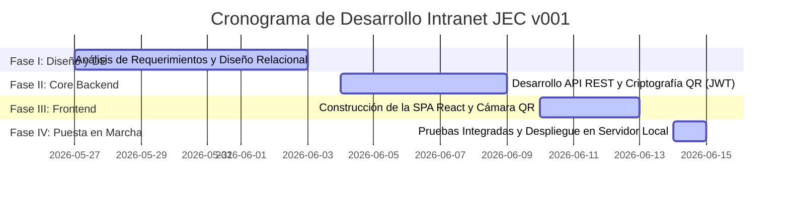

# INFORME TÉCNICO DE AVANCE Y LANZAMIENTO — INTRANET JEC v001
**I.E. HUANOQUITE — COORDINACIÓN DE INNOVACIÓN Y SOPORTE TECNOLÓGICO (CIST)**

---

**A:** Dirección de la Institución Educativa Huanoquite  
**DE:** Ing. Eddam Eloy Huallpa Lima — Especialista CIST  
**ASUNTO:** Informe Técnico del Desarrollo y Puesta en Marcha de la v001 de la Plataforma "Intranet JEC"  
**FECHA:** 16 de Junio de 2026  
**PERIODO DE AVANCE:** 27 de Mayo de 2026 al 15 de Junio de 2026  

---

## 1. INTRODUCCIÓN Y JUSTIFICACIÓN DEL PROYECTO

El Aula de Innovación Pedagógica (AIP) de la **I.E. Huanoquite** es el núcleo de la integración tecnológica de los docentes y alumnos. Sin embargo, su operación diaria presenta desafíos logísticos críticos:
1. **Pérdida de Tiempo Pedagógico:** Registrar de forma manual la asistencia y asignar una a una las laptops o tabletas a los alumnos consume entre 10 a 15 minutos del bloque de clase.
2. **Vulnerabilidad de Activos:** La falta de un registro automatizado de quién utiliza cada laptop en cada hora de clase dificulta identificar responsables directos ante deterioros o pérdidas físicas del hardware.
3. **Limitación de Conectividad:** La inestabilidad o ausencia total del servicio de internet de banda ancha imposibilita el uso de plataformas comerciales basadas en la nube.

Para resolver de manera definitiva estas problemáticas, la **Coordinación CIST**, bajo el liderazgo del **Ing. Eddam Eloy Huallpa Lima**, ha desarrollado la **Intranet JEC**. Se trata de un sistema de gestión educativa y control de activos diseñado para operar de manera **100% offline** (dentro de la red de área local - LAN del colegio), permitiendo transacciones instantáneas, control de inventario en tiempo real mediante credenciales QR criptográficas y un aula virtual adaptativa.

El presente informe detalla el cronograma de desarrollo, la arquitectura de software implementada y la exitosa puesta en marcha de la **versión v001** del sistema funcional al 15 de junio de 2026.

---

## 2. FICHA TÉCNICA DEL SISTEMA (v001)

| Componente | Detalle Técnico |
| --- | --- |
| **Nombre del Software** | Sistema Integrado Intranet JEC — I.E. Huanoquite |
| **Versión Actual** | v001 (Lanzamiento Funcional) |
| **Arquitectura de Red** | Red Local LAN (Cero dependencia de internet) |
| **Base de Datos** | PostgreSQL (Motor relacional estructurado y robusto) |
| **Capa de Servidor (Backend)** | Java 17 LTS + Spring Boot 3.x (API REST en N-Capas) |
| **Capa de Cliente (Frontend)** | React 18 + Vite 8 + Tailwind CSS (Single Page Application) |
| **Seguridad de Acceso** | JSON Web Tokens (JWT) firmados mediante algoritmo HMAC-SHA256 |
| **Integración de Lectores** | Biblioteca `html5-qrcode` para control directo de cámaras web/móviles |
| **Generador de Documentos** | `jsPDF` + `react-qr-code` para credenciales y actas firmadas |

---

## 3. CRONOGRAMA DE ACTIVIDADES Y AVANCE POR FASES

El proyecto fue desarrollado y puesto en marcha en un ciclo de cuatro (04) fases consecutivas y aceleradas entre el 27 de mayo y el 15 de junio de 2026:

### 3.1. Fase I: Análisis de Requerimientos e Infraestructura de Datos (27 de mayo – 03 de junio)
* **Objetivo:** Establecer las bases técnicas y modelar la base de datos para soportar los flujos del Aula AIP de forma integrada.
* **Actividades Realizadas:**
  * Diagnóstico del flujo de tránsito de docentes y alumnos en el Aula AIP.
  * Diseño del modelo entidad-relación normalizado en PostgreSQL utilizando un esquema de **Herencia Relacional (1:1)** mediante la tabla maestra `usuarios` y perfiles específicos (`estudiantes` y `personal_institucional`), lo que garantiza la integridad referencial y previene duplicidades.
  * Implementación del patrón transaccional **Maestro-Detalle (`sesiones_grupales` -> `sesiones_detalle`)**, asegurando que toda acción en el AIP cuente con un docente responsable legal de los equipos.

### 3.2. Fase II: Desarrollo del Core Backend y Seguridad QR Criptográfica (04 de junio – 09 de junio)
* **Objetivo:** Construir el motor lógico centralizado del sistema y el mecanismo de seguridad offline.
* **Actividades Realizadas:**
  * Programación de la API RESTful en Spring Boot estructurada bajo una arquitectura de capas (`controllers`, `services`, `repositories`, `models`, `dtos`).
  * Implementación del servicio de seguridad criptográfica: para evitar la falsificación de credenciales impresas por parte de los estudiantes, los códigos QR contienen un token **JWT firmado digitalmente** por el servidor local con una clave secreta HMAC-SHA256 (`SECRET_KEY`).
  * Desarrollo del motor transaccional de **Asignación Predictiva**: un solo endpoint `/api/v1/sesiones/iniciar-clase` que cruza la sección matriculada con los equipos disponibles del AIP y realiza un registro masivo en bloque.

### 3.3. Fase III: Desarrollo Frontend y Conectividad Local (10 de junio – 13 de junio)
* **Objetivo:** Diseñar una interfaz responsiva, intuitiva y veloz para el CIST y los docentes.
* **Actividades Realizadas:**
  * Programación de la interfaz SPA interactiva en React 18, empaquetada con Vite para cargas ultrarrápidas a nivel de LAN.
  * Implementación del diseño estético visual con una paleta de colores premium basada en HSL (Modo Claro verde institucional y Modo Oscuro CIST para reducir la fatiga visual).
  * Integración de la biblioteca `html5-qrcode` para acceder a la cámara nativa de cualquier tableta, celular o laptop cliente de manera local, logrando decodificar y validar los JWT de los códigos QR en menos de 0.5 segundos.

### 3.4. Fase IV: Pruebas, Despliegue en Servidor y Puesta en Marcha (14 de junio – 15 de junio)
* **Objetivo:** Compilar, realizar pruebas de carga integradas y liberar el sistema funcional.
* **Actividades Realizadas:**
  * Compilación del backend en un empaquetado `.jar` de Java y despliegue como servicio persistente del sistema (Systemd) en el servidor Linux local reactivado.
  * Configuración del firewall (UFW) y del direccionamiento IP local (ej. `192.168.1.100`) para el libre consumo de dispositivos conectados por Wi-Fi o cable.
  * Realización de simulaciones de ingreso de alumnos de 3° de secundaria con escaneo QR del docente responsable, confirmando la asignación secuencial instantánea en base de datos.
  * **Hito de Cierre (15 de Junio):** Lanzamiento oficial y declaratoria de operatividad de la versión **v001**.

---

## 4. DETALLE DE MÓDULOS OPERATIVOS IMPLEMENTADOS

El sistema lanzado en su versión **v001** cuenta con los siguientes módulos completamente funcionales:

### 4.1. Módulo de Gestión de Identidad QR
* **Funcionalidad:** Permite registrar estudiantes y personal, asociando un DNI y grado/sección a un token QR único.
* **Operatividad:** El docente y el CIST pueden ver su credencial en pantalla y presionar un botón de exportación para compilar en formato PDF A4 lotes de fotochecks listos para impresión física.

### 4.2. Módulo de Control de Aulas AIP
* **Funcionalidad:** Gestión espacial de las áreas tecnológicas habilitadas (AIP 01, AIP 02, AIP 03).
* **Operatividad:** Muestra en tiempo real la disponibilidad física del hardware de cada aula y monitorea la latencia de la conexión de red (Ping).

### 4.3. Estación de Escaneo Multimodo (Modo Kiosco de Puerta)
Instalada en la puerta del AIP mediante una tableta o monitor con cámara, actúa como el centro operativo del aula:
1. **Modo Clase AIP:** El docente presenta su QR, selecciona el aula base (ej. AIP 01), grado/sección (ej. 3ro A) y tema. De forma automática, el sistema consulta los alumnos matriculados y las laptops operativas del aula, emparejando secuencialmente (Estudiante $N$ con Laptop $N$) y bloqueando las laptops en la base de datos.
2. **Modo Hora Colegiada / Refuerzo:** Registra reuniones del personal por áreas curriculares (EPT, Matemáticas, Ciencias, etc.) y guarda la agenda tratada para auditoría de la dirección.
3. **Modo Préstamo Externo:** Permite al docente retirar tabletas/laptops para llevar a sus aulas de clase regular. El sistema activa un escáner continuo donde se pasan los QRs de los equipos y se cargan a la cuenta del docente responsable.
4. **Firma Digital y Cierre de Sesión:** Al retirarse, el docente vuelve a aproximar su fotocheck QR. El sistema muestra la sesión abierta y solicita una re-confirmación para estampar la firma digital de salida, liberando todos los equipos de forma atómica y devolviéndolos al inventario disponible (`EN_AIP`).
5. **Actas en PDF:** Genera constancias firmadas digitalmente con la lista de marcas y códigos patrimoniales prestados/devueltos para uso de control interno del CIST.
6. **Módulo de Contingencia Manual:** Si un docente no porta su fotocheck, el administrador CIST puede buscarlo en la lista activa, registrar su ingreso, seleccionar los equipos y procesar el cierre manualmente.

---

## 5. LOGROS OBTENIDOS Y BENEFICIOS INSTITUCIONALES

Con la puesta en marcha de la **v001**, se han alcanzado los siguientes beneficios para la comunidad educativa:
* **Ahorro de Tiempo de Clase:** El ingreso al AIP se reduce de 15 minutos de registro manual a menos de **1 minuto** mediante escaneos rápidos y asignación automática por número de orden.
* **Control Patrimonial Riguroso:** Cada sesión de aprendizaje o préstamo externo queda respaldada por un identificador de sesión (`id_sesion`), un docente responsable con firma JWT y un registro atómico de qué alumno usó cada laptop. Ante fallas físicas, el CIST puede identificar al responsable en segundos.
* **Cero Costo de Licenciamiento:** El stack tecnológico se basa íntegramente en herramientas de código abierto (PostgreSQL, Java Spring Boot, React, Linux), evitando costos adicionales para la institución.
* **Operación Offline Autónoma:** La plataforma funciona sin internet, garantizando estabilidad absoluta y protegiendo el flujo educativo frente a cortes del proveedor de telecomunicaciones.

---

## 6. PRÓXIMOS PASOS (FASES FUTURAS)

Para maximizar el impacto de la plataforma a partir del presente avance, la coordinación CIST propone:
1. **Capacitación General al Personal Docente:** Talleres prácticos sobre el uso de la Estación de Escaneo y descarga de fotochecks digitales.
2. **Impresión y Distribución de Credenciales Físicas:** Emisión de fotochecks en formato carnet de alta resistencia para todos los docentes y estudiantes de la institución.
3. **Despliegue del Aula Virtual (Fase Académica):** Habilitar progresivamente las pestañas del Aula Virtual (Materiales de Clase, Libro de Calificaciones con exportación a Excel y Foros de Debate) que ya se encuentran diseñadas en el frontend.

---

   

  <table style="border: none; border-collapse: collapse; width: 100%;">
    <tr style="border: none;">
      <td style="border: none; text-align: center; width: 50%;">
        __________________________________________ 
        <b>Ing. Eddam Eloy Huallpa Lima</b> 
        Especialista CIST / Coordinador Técnico 
        I.E. Huanoquite
      </td>
      <td style="border: none; text-align: center; width: 50%;">
        __________________________________________ 
        <b>Firma de Recepción / Sello</b> 
        Dirección de la Institución Educativa 
        I.E. Huanoquite
      </td>
    </tr>
  </table>

