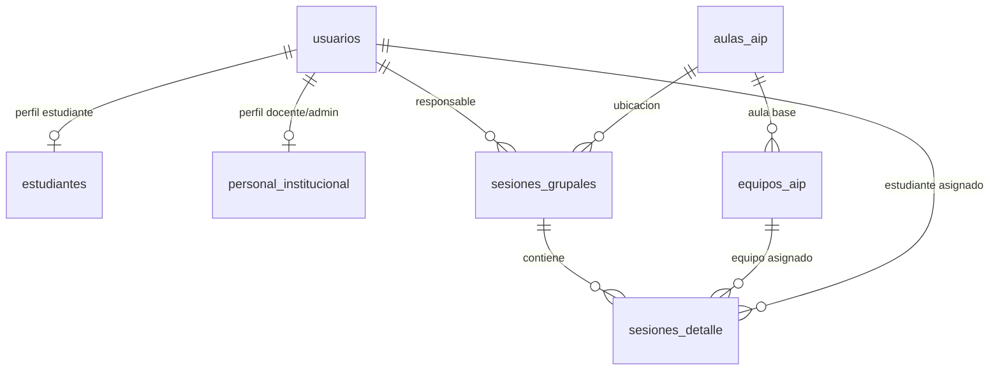

# Intranet JEC - Backend API 🚀

Este es el backend del **Sistema Integrado Intranet JEC** diseñado para la **I.E. Huanoquite**. Su objetivo principal es automatizar el control patrimonial, préstamo y asignación de hardware educativo (laptops y tabletas) en entornos locales sin acceso a internet.

---

## 🏛️ Arquitectura y Paquetes

La aplicación está construida sobre **Java Spring Boot 3.x / 4.x** y estructurada bajo un patrón multicapa clásico:

*   **`com.jec.cist.models`**: Entidades persistentes mapeadas con JPA/Hibernate.
*   **`com.jec.cist.repositories`**: Interfaces de acceso a datos utilizando Spring Data JPA.
*   **`com.jec.cist.services`**: Implementación de la lógica de negocio (seguridad JWT, renderizado QR y lógica transaccional).
*   **`com.jec.cist.dtos`**: Clases Data Transfer Object para validación de entrada (`jakarta.validation`) y serialización de salida.
*   **`com.jec.cist.controllers`**: Controladores REST anotados con Spring MVC y OpenAPI/Swagger.
*   **`com.jec.cist.config`**: Clases de configuración (Seguridad permisiva en desarrollo e inicialización de base de datos).

---

## 🗄️ Modelo Relacional de Base de Datos

El motor de persistencia utiliza **PostgreSQL** y se estructura bajo las siguientes relaciones de integridad:



### Relaciones clave:
*   **Herencia Relacional (1:1):** Las tablas `estudiantes` y `personal_institucional` extienden la información de `usuarios` compartiendo la misma clave primaria (`id_usuario` UUID) mediante `@MapsId`, evitando la duplicidad de registros y simplificando los joins.
*   **Restricciones de Integridad (FKs):** La tabla `sesiones_detalle` enlaza de forma segura la sesión grupal, el equipo AIP asignado y el estudiante receptor.

---

## 🔒 Seguridad y Criptografía QR Offline

Para permitir un funcionamiento autónomo y robusto en la red LAN local del colegio (sin internet):
1.  **Criptografía QR:** El código QR de los fotochecks físicos almacena un token **JWT (JSON Web Token)** firmado criptográficamente en el servidor mediante el algoritmo **HMAC-SHA256** utilizando una clave simétrica local.
2.  **Payload del QR:** El JWT contiene claims mínimos de identidad:
    ```json
    {
      "id_usuario": "UUID",
      "dni": "8-dígitos",
      "rol": "ESTUDIANTE | DOCENTE | CIST | ADMINISTRATIVO"
    }
    ```
3.  **Generación de QR Base64:** `QrService` utiliza la librería **ZXing** para renderizar este JWT en una imagen QR PNG codificada en **Base64**, facilitando al frontend la visualización instantánea y la impresión de credenciales en PDF.

---

## ⚙️ Motor de Asignación y Emparejamiento

El núcleo del backend (`SesionService`) implementa dos modos operativos transaccionales clave:

### 1. Modo Clase AIP (Asignación Predictiva)
*   **Entrada:** QR del Docente responsable, Aula AIP física, y la cadena de Grado y Sección (ej. "3ro A").
*   **Lógica:**
    1. Valida criptográficamente el JWT del docente escaneado.
    2. Consulta los estudiantes activos matriculados en ese grado y sección, ordenados de forma ascendente por su **número de orden**.
    3. Consulta las laptops del aula base operativa que figuren como disponibles (`EN_AIP`), ordenadas ascendentemente por su **código patrimonial**.
    4. Empareja de forma secuencial y determinista a cada estudiante con una laptop (Estudiante $N$ ↔ Laptop $N$).
    5. Asienta en bloque la cabecera (`sesiones_grupales`) y los detalles (`sesiones_detalle`).
    6. Cambia el estado de ubicación de los equipos a `PRESTADO_AULA` en una única transacción de base de datos.

### 2. Modo Préstamo Externo (Salida de Tabletas)
*   **Entrada:** QR del Docente, Aula AIP de origen y una lista de QRs de los equipos escaneados físicamente (tabletas/laptops).
*   **Lógica:**
    1. Valida el JWT del docente responsable.
    2. Registra una sesión grupal de tipo `PRESTAMO_EXTERNO`.
    3. Asocia cada equipo escaneado en `sesiones_detalle` con el estudiante en `NULL`, delegando la responsabilidad de cargo directo al docente.
    4. Cambia la ubicación de los equipos a `PRESTADO_AULA`.

### 3. Retorno y Cierre Masivo
Al finalizar la clase o devolver el lote de equipos, el endpoint de cierre actualiza la `hora_fin` de la sesión y restaura automáticamente el estado de ubicación de todos los equipos vinculados a `EN_AIP`.

---

## 🔌 Endpoints REST del API

La API cuenta con las siguientes rutas base expuestas bajo el prefijo `/api/v1`:

### 1. Usuarios e Identidad (`/api/v1/usuarios`)
*   `POST /registro`: Registra un usuario y genera su token QR criptográfico.
*   `GET /{id}`: Obtiene el perfil detallado del usuario (incluyendo datos de estudiante o personal).
*   `GET /{id}/credencial`: Retorna los metadatos del usuario y el código QR renderizado en Base64 PNG.

### 2. Equipos e Inventario (`/api/v1`)
*   `POST /equipos/alta`: Da de alta un nuevo equipo (Laptop, Tableta, PC) asociándolo a un aula base.
*   `GET /aulas/{idAula}/inventario`: Retorna en tiempo real los equipos registrados en el aula y su ubicación actual (`EN_AIP` / `PRESTADO_AULA`).

### 3. Transacciones y Préstamos (`/api/v1/sesiones`)
*   `POST /iniciar-clase`: Inicia una sesión Modo Clase AIP emparejando automáticamente laptops a estudiantes.
*   `POST /registrar-prestamo`: Inicia un préstamo externo de hardware (tabletas) a cargo directo de un docente.
*   `PUT /{idSesion}/finalizar`: Cierra la sesión y libera todo el hardware devolviéndolo al estado disponible.

---

## 📖 Documentación OpenAPI (Swagger)

El backend expone la documentación interactiva detallada del API mediante **Springdoc OpenAPI**.

*   **Swagger UI (Interactiva):** `http://localhost:8080/swagger-ui.html`
*   **Documentación API Docs (JSON):** `http://localhost:8080/v3/api-docs`

---

## 🛠️ Configuración y Arranque Local

### Requisitos previos:
*   **Java 17** instalado.
*   **PostgreSQL** ejecutándose con la base de datos `intranet_jec` creada.
*   Credenciales por defecto configuradas en PostgreSQL: usuario `postgres` y contraseña `postgres`.

### Comando de Arranque:
Usa el Maven Wrapper provisto en la carpeta del backend:
```bash
./mvnw spring-boot:run
```

---

## 🗃️ Datos de Prueba Iniciales (Seeding)

Para facilitar la ejecución de pruebas del flujo completo en la primera corrida, la aplicación cuenta con un `DataLoader` automático que insertará los siguientes datos si la base de datos se encuentra vacía:
*   **Docente de Prueba (Para iniciar clase/préstamos):**
    *   **DNI:** `11223344`
    *   *Nota:* Al iniciar el servidor, el log de consola imprimirá el token JWT del docente que puedes copiar y pegar para simular el escaneo QR.
*   **Estudiantes (3° A):** 5 estudiantes registrados con números de orden del 1 al 5.
*   **Laptops de Prueba:** 5 laptops operativas en el `AIP 01`.
*   **Tabletas de Prueba:** 3 tabletas operativas en el `AIP 02` (QRs: `QR-TAB-AIP2-001`, `QR-TAB-AIP2-002`, `QR-TAB-AIP2-003`).
